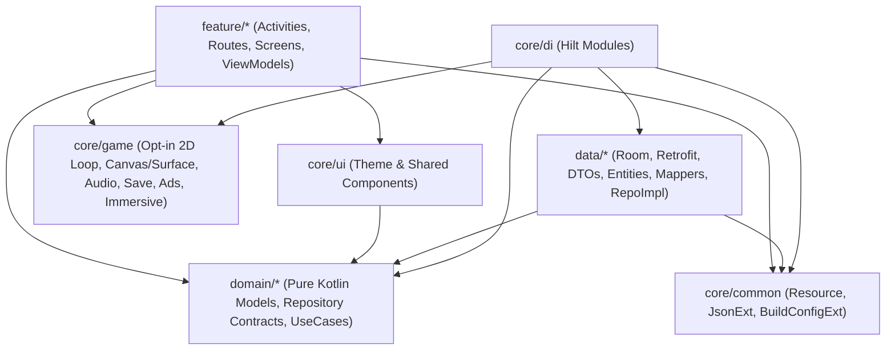

# Architecture Guide — `init-android-apps`

## 1. Overview & Architecture Principles

`init-android-apps` follows **Google's Official Guide to App Architecture** and *Now in Android* conventions in a **single-module (`:app`) Clean Architecture** layout partitioned into four top-level layers (`core/`, `data/`, `domain/`, `feature/`) backed by a Gradle composite build (`build-logic/convention`) for shared convention plugins.

- **Why single-module:** Cloning and customizing a starter template stays fast and low-ceremony with a single Gradle module. Strict package-level dependency rules mirror multi-module boundaries so the project can be split into `:core:*`, `:data`, `:domain`, and `:feature:*` modules later with minimal refactoring.
- **Build Logic (`build-logic/convention`):** Included via `includeBuild("build-logic")` in root `settings.gradle.kts` and reading dependency coordinates strictly from root `gradle/libs.versions.toml`. Four focused convention plugins under `io.github.amirisback.androidapp.convention` encapsulate repetitive Gradle wiring while keeping `app/build.gradle.kts` declarative:
  - `androidapp.android.application` (`AndroidApplicationConventionPlugin`) — AGP 9.5.1 application config (SDK 24/37, built-in Kotlin with JVM 17 compiler options — never applies `org.jetbrains.kotlin.android`), `BuildConfig` (`DATABASE_NAME`, `PREF_NAME`), debug/release `resValue`s (`app_name`, `admob_*`), release signing & ProGuard, and `base.archivesName`.
  - `androidapp.android.application.compose` (`AndroidApplicationComposeConventionPlugin`) — Compose compiler plugin, `buildFeatures.compose = true`, Compose BOM, and core Compose/M3/Activity/Lifecycle/Tooling dependencies.
  - `androidapp.android.hilt` (`AndroidHiltConventionPlugin`) — KSP + Hilt plugin wiring (`hilt-android` + `hilt-compiler`).
  - `androidapp.android.room` (`AndroidRoomConventionPlugin`) — KSP plugin, `room.schemaLocation` (`$projectDir/schemas`), and `room-compiler`.
  - App identity & AdMob configuration objects live in `build-logic/convention/src/main/kotlin/io/github/amirisback/androidapp/convention/ProjectSetting.kt` and `ProjectAds.kt`.
- **Core principles:**
  - Strict separation of concerns (`DTO` vs `Entity` vs pure Kotlin `Domain Model`).
  - Unidirectional Data Flow (UDF) with Jetpack Compose Material 3.
  - Constructor-injected dependencies via Hilt (`@Singleton` for infrastructure, `@ViewModelScoped` for use cases) and injectable coroutine dispatchers (`@IoDispatcher`) for deterministic JVM unit tests.

---

## 2. Canonical Package Tree

### Main Source Tree (`app/src/main/java/io/github/amirisback/androidapp/`)

```text
io.github.amirisback.androidapp/
|-- ProjectApplication.kt
|-- core/
|   |-- common/
|   |   |-- BuildConfigExt.kt
|   |   |-- JsonExt.kt
|   |   |-- Resource.kt
|   |-- di/
|   |   |-- DatabaseModule.kt
|   |   |-- DispatcherModule.kt
|   |   |-- GameModule.kt
|   |   |-- NetworkModule.kt
|   |   |-- RepositoryModule.kt
|   |   |-- UseCaseModule.kt
|   |-- game/
|   |   |-- ads/
|   |   |   |-- AdMobRewardedAdController.kt
|   |   |   |-- RewardedAdController.kt
|   |   |   |-- RewardedAdState.kt
|   |   |-- audio/
|   |   |   |-- AndroidGameAudioManager.kt
|   |   |   |-- GameAudioController.kt
|   |   |-- loop/
|   |   |   |-- FixedTimestepClock.kt
|   |   |   |-- GameLoopController.kt
|   |   |-- render/
|   |   |   |-- GameCanvas.kt
|   |   |   |-- GameSurfaceView.kt
|   |   |-- save/
|   |   |   |-- DataStoreGameSaveStore.kt
|   |   |   |-- GameSaveSnapshot.kt
|   |   |   |-- GameSaveStore.kt
|   |   |-- window/
|   |       |-- ImmersiveModeEffect.kt
|   |-- ui/
|       |-- component/
|       |   |-- AppTopAppBar.kt
|       |   |-- CommonState.kt
|       |   |-- MealCard.kt
|       |-- theme/
|           |-- Color.kt
|           |-- Theme.kt
|           |-- Type.kt
|-- data/
|   |-- local/
|   |   |-- dao/
|   |   |   |-- MealDao.kt
|   |   |-- database/
|   |   |   |-- AppDatabase.kt
|   |   |   |-- DatabaseConfig.kt
|   |   |-- entity/
|   |   |   |-- MealEntity.kt
|   |   |-- MealLocalDataSource.kt
|   |-- mapper/
|   |   |-- MealMapper.kt
|   |-- remote/
|   |   |-- api/
|   |   |   |-- MealApiConfig.kt
|   |   |   |-- MealApiService.kt
|   |   |-- dto/
|   |   |   |-- AreaDto.kt
|   |   |   |-- CategoryDto.kt
|   |   |   |-- CategoryResponseDto.kt
|   |   |   |-- IngredientDto.kt
|   |   |   |-- MealDto.kt
|   |   |   |-- MealFilterDto.kt
|   |   |   |-- MealResponseDto.kt
|   |   |-- MealRemoteDataSource.kt
|   |-- repository/
|       |-- MealRepositoryImpl.kt
|-- domain/
|   |-- model/
|   |   |-- Area.kt
|   |   |-- Category.kt
|   |   |-- Ingredient.kt
|   |   |-- Meal.kt
|   |   |-- MealFilter.kt
|   |-- repository/
|   |   |-- MealRepository.kt
|   |-- usecase/
|       |-- MealInteractor.kt
|       |-- MealUseCase.kt
|-- feature/
    |-- about/
    |   |-- AboutUsActivity.kt
    |   |-- AboutUsScreen.kt
    |-- detail/
    |   |-- DetailActivity.kt
    |   |-- DetailScreen.kt
    |   |-- DetailUiState.kt
    |   |-- DetailViewModel.kt
    |-- favorite/
    |   |-- FavoriteScreen.kt
    |   |-- FavoriteUiState.kt
    |   |-- FavoriteViewModel.kt
    |-- game/
    |   |-- GameActivity.kt
    |   |-- GameScreen.kt
    |   |-- GameUiState.kt
    |   |-- GameViewModel.kt
    |-- main/
        |-- MainActivity.kt
        |-- MainScreen.kt
        |-- MainUiState.kt
        |-- MainViewModel.kt
```

### Unit Test Source Tree (`app/src/test/java/io/github/amirisback/androidapp/`)

```text
io.github.amirisback.androidapp/
|-- core/
|   |-- common/
|   |   |-- JsonExtTest.kt
|   |-- game/
|       |-- loop/
|       |   |-- FixedTimestepClockTest.kt
|       |   |-- GameLoopControllerTest.kt
|       |-- save/
|           |-- DataStoreGameSaveStoreTest.kt
|-- data/
|   |-- mapper/
|   |   |-- MealMapperTest.kt
|   |-- repository/
|       |-- MealRepositoryImplTest.kt
|-- feature/
|   |-- detail/
|   |   |-- DetailViewModelTest.kt
|   |-- favorite/
|   |   |-- FavoriteViewModelTest.kt
|   |-- game/
|   |   |-- GameViewModelTest.kt
|   |-- main/
|       |-- MainViewModelTest.kt
|-- testutil/
    |-- FakeGameAudioController.kt
    |-- FakeGameSaveStore.kt
    |-- FakeMealApiService.kt
    |-- FakeMealDao.kt
    |-- FakeMealUseCase.kt
    |-- FakeRewardedAdController.kt
    |-- MainDispatcherRule.kt
```

---

## 3. Layer Dependency Diagram & Import Boundaries



### Import Boundary Matrix

| Package | Allowed Imports | Forbidden Imports |
|---|---|---|
| `domain/` | Kotlin stdlib, `kotlinx.coroutines.*`, `javax.inject.Inject`, `core.common.Resource` | `android.*`, `androidx.*`, `retrofit2.*`, `com.google.gson.*`, `okhttp3.*`, `data.*`, `feature.*`, `core.game.*` |
| `data/` | `domain.*`, `core.common.*`, `core.di.IoDispatcher`, `androidx.room.*`, `retrofit2.*`, `com.google.gson.*`, `okhttp3.*`, `javax.inject.*` | `feature.*`, `androidx.compose.*` |
| `feature/` | `domain.*`, `core.ui.*`, `core.game.*`, `core.common.*`, `androidx.compose.*`, `androidx.lifecycle.*`, `androidx.activity.*`, `com.frogobox.*`, `dagger.hilt.*` | `data.*` (never import DAO, Entity, DTO, API Service, or `MealRepositoryImpl`) |
| `core/game/` | Kotlin stdlib, `kotlinx.coroutines.*`, `core.di.IoDispatcher`, `androidx.compose.*`, `androidx.lifecycle.*`, `androidx.datastore.*`, `com.google.android.gms.ads.*`, Android media/window APIs, Hilt | `data.*`, `feature.*` |
| `core/di/` | `data.*`, `domain.*`, `core.game.*`, `core.common.*`, Hilt, Room, DataStore, Retrofit, OkHttp, Chucker | `feature.*`, `androidx.compose.*` |
| `core/ui/` | `androidx.compose.*`, `coil3.*`, `domain.model.*`, `R` | `data.*`, `feature.*` |

---

## 4. Naming Conventions

| Artifact | Suffix / Pattern | Package |
|---|---|---|
| Pure domain entity | Plain noun (`Meal`, `Category`) | `domain/model/` |
| Repository contract | `*Repository` | `domain/repository/` |
| UseCase contract / implementation | `*UseCase` / `*Interactor` | `domain/usecase/` |
| Retrofit API interface | `*ApiService` | `data/remote/api/` |
| API URLs & query constants | `*ApiConfig` | `data/remote/api/` |
| Network JSON payload | `*Dto`, `*ResponseDto` | `data/remote/dto/` |
| Room table | `*Entity` | `data/local/entity/` |
| Room DAO | `*Dao` (`suspend fun` queries/mutations) | `data/local/dao/` |
| Room Database | `AppDatabase` | `data/local/database/` |
| Data sources | `*RemoteDataSource`, `*LocalDataSource` | `data/remote/`, `data/local/` |
| Model mappers | `*Mapper.kt` (`toDomain()`, `toEntity()`) | `data/mapper/` |
| Repository implementation | `*RepositoryImpl` | `data/repository/` |
| Feature UI state | `*UiState` | `feature/<name>/` |
| Feature ViewModel | `*ViewModel` | `feature/<name>/` |
| Feature Compose screen | `*Screen.kt` (`<Name>Route` + stateless `<Name>Screen` + `@Preview`) | `feature/<name>/` |
| Activity host | `*Activity` | `feature/<name>/` |
| Hilt DI module | `*Module` | `core/di/` |

---

## 5. "Where to Put X" Quick Decision Table

| If you need to add or modify... | Put it here |
|---|---|
| A new pure business data class | `domain/model/<Name>.kt` |
| A repository contract consumed by domain/UI | `domain/repository/<Name>Repository.kt` |
| Business logic orchestrating one or more repositories | `domain/usecase/` |
| A new Retrofit HTTP endpoint | `data/remote/api/<Name>ApiService.kt` + URL constants in `<Name>ApiConfig.kt` |
| A Gson JSON request/response payload | `data/remote/dto/<Name>Dto.kt` (covered by `proguard-rules.pro` keep rule) |
| A new Room table & queries | `data/local/entity/<Name>Entity.kt`, `data/local/dao/<Name>Dao.kt`, register in `AppDatabase.kt` |
| DTO/Entity <-> Domain conversion logic | `data/mapper/<Name>Mapper.kt` |
| Network/DB error handling & dispatcher switching | `data/remote/<Name>RemoteDataSource.kt` or `data/local/<Name>LocalDataSource.kt` |
| A Hilt `@Provides` or `@Binds` wiring | `core/di/<Area>Module.kt` |
| A coroutine dispatcher qualifier (`@IoDispatcher`, `@DefaultDispatcher`) | `core/di/DispatcherModule.kt` |
| A shared Compose widget (e.g., top bar, card, loading/empty/error view) | `core/ui/component/` |
| Material 3 colors, typography, or `InitTheme` | `core/ui/theme/` |
| Reusable 2D game loop, Canvas/SurfaceView renderer, audio, save store, rewarded ads, or immersive mode | `core/game/` (`loop/`, `render/`, `audio/`, `save/`, `ads/`, `window/`) |
| Screen-specific state, ViewModel, Route, and stateless Screen | `feature/<featureName>/` |
| App metadata, version, signing, or AdMob unit IDs | `build-logic/convention/src/main/kotlin/io/github/amirisback/androidapp/convention/ProjectSetting.kt` or `ProjectAds.kt` |
| Reusable Gradle convention plugin or build-system configuration | `build-logic/convention/src/main/kotlin/io/github/amirisback/androidapp/convention/` (registered in `build-logic/convention/build.gradle.kts` & `gradle/libs.versions.toml`) |
| Fast JVM unit tests and test fakes | `app/src/test/java/io/github/amirisback/androidapp/` (mirroring main packages) |

---

## 6. Unidirectional Data Flow (UDF) Pattern

```text
  UI Event (onMealClick / onAddFavoriteClick / searchMeal)
        |
        v
  <Feature>ViewModel (extends androidx.lifecycle.ViewModel)
        |  calls MealUseCase -> MealRepository -> DataSources
        |  maps Resource<T> -> immutable *UiState
        v
  StateFlow<*UiState>
        |  collected via collectAsStateWithLifecycle()
        v
  <Feature>Route  --->  stateless <Feature>Screen(uiState, callbacks) + @Preview
```

- **State ownership:** Each stateful feature exposes a single `StateFlow<*UiState>` (`sealed interface` for mutually exclusive screens like `MainUiState` / `FavoriteUiState`, or `data class` when content remains visible alongside overlays/events like `DetailUiState`).
- **One-shot UI events:** Modeled as nullable fields on `UiState` (e.g., `userMessage`, `errorMessage`, `isDeleted`), handled via `LaunchedEffect` in `<Feature>Route`, and cleared via explicit `consume*()` callbacks on the ViewModel.
- **Previews:** Every `<Feature>Screen` and shared component in `core/ui/component/` is stateless and accompanied by `@Preview` composables wrapped in `InitTheme`.

---

## 7. How to Add a New Feature (Step-by-Step)

1. **Domain Layer:** Define immutable Kotlin model(s) in `domain/model/<Name>.kt`, repository interface in `domain/repository/<Name>Repository.kt`, and use case contract/interactor in `domain/usecase/`.
2. **Data Layer:** Add Retrofit DTOs in `data/remote/dto/`, endpoint methods in `data/remote/api/`, Room `@Entity` and `suspend` `@Dao` in `data/local/` (if persisted; bump `AppDatabase` version and add migration), and bidirectional mappers in `data/mapper/`.
3. **Data Sources & Repository:** Implement `*RemoteDataSource` / `*LocalDataSource` injecting `@IoDispatcher` and rethrowing `CancellationException`, then implement `*RepositoryImpl` in `data/repository/`.
4. **Dependency Injection:** Wire providers/bindings in `core/di/` (`NetworkModule`, `DatabaseModule`, `RepositoryModule`, `UseCaseModule`).
5. **Feature UI:** Create `feature/<name>/` with `<Name>UiState.kt`, `<Name>ViewModel.kt` (extending `ViewModel`), `<Name>Screen.kt` (`<Name>Route` using `collectAsStateWithLifecycle()` + stateless `<Name>Screen` + `@Preview`), and `<Name>Activity.kt` (extending `FrogoComposeActivity` with `enableEdgeToEdge()`, only if standalone).
6. **Manifest & Resources:** Register any standalone Activity in `app/src/main/AndroidManifest.xml` with explicit `android:exported="false"` (unless launcher/deep-link), and place all UI strings/content descriptions in `app/src/main/res/values/strings.xml`.
7. **Unit Tests:** Add JVM unit tests under `app/src/test/java/io/github/amirisback/androidapp/` covering mappers, repository behavior, and ViewModel state transitions using hand-written fakes.
8. **Verify:** Run `./gradlew assembleDebug testDebugUnitTest lintDebug`, confirm zero `@Suppress` annotations, and commit updated Room schema JSON under `app/schemas/` if the database schema changed.

---

## 8. Opt-In 2D Game Starter Mode (`core/game/` & `feature/game/`)

This template works out of the box as **either** a standard Android app starter (`MainActivity` remains the default launcher) **or** a 2D casual/puzzle/board game starter (including native Kotlin rewrites of Unity 2D games):

- **How to switch into Game Starter mode:** Move the `<intent-filter>` (`MAIN` / `LAUNCHER`) from `.feature.main.MainActivity` to `.feature.game.GameActivity` (setting `android:exported="true"`) in `app/src/main/AndroidManifest.xml`, or build your own `feature/<game>/` screens consuming `core/game/`.
- **Zero-cost opt-in:** `MobileAdsInitProvider` is removed in `app/src/main/AndroidManifest.xml` via `tools:node="remove"`, so standard non-game apps incur zero AdMob initialization overhead and never crash in release builds when AdMob IDs are blank. `GameModule` binds `GameSaveStore`, `GameAudioController`, and `RewardedAdController` lazily via Hilt; `MobileAds.initialize` is only invoked on first `RewardedAdController.preload()` when both `admob_app_id` and `admob_rewarded_id` are non-blank. Before shipping Rewarded Ads in release, configure both `ProjectSetting.ADMOB_APP_ID` and `ProjectAds.Admob.REWARDED_ID`.
- **Unity 2D REA Rewrite Mapping:**

| Unity 2D Concept | Native Replacement in `core/game/` |
|---|---|
| `FixedUpdate(fixedDeltaTime)` | `FixedTimestepClock` + `GameCanvas(onFixedUpdate = ...)` or `GameSurfaceHost(onFixedUpdate = ...)` |
| `Time.timeScale = 0` / pause state | `GameLoopController` (`IDLE` / `RUNNING` / `PAUSED`) |
| 2D Sprite / Canvas rendering | `GameCanvas` (Compose `DrawScope`) or `GameSurfaceHost` (`SurfaceView` + Android `Canvas`) |
| `PlayerPrefs` / local save | `GameSaveStore` (`DataStoreGameSaveStore` backed by DataStore Preferences) |
| `AudioSource` / `AudioClip` (SFX + BGM) | `GameAudioController` (`AndroidGameAudioManager` via `SoundPool` + `MediaPlayer`) + `GameAudioLifecycleEffect` |
| Google Mobile Ads Rewarded | `RewardedAdController` (`AdMobRewardedAdController`, configured in `ProjectAds.kt`) |
| Fullscreen + `Screen.sleepTimeout` | `ImmersiveModeEffect(enabled = true, keepScreenOn = true)` |

### Pruning Checklist (Keep Only What You Need)

Both tracks share only `ProjectApplication.kt`, `core/common/`, `core/di/DispatcherModule.kt`, `core/ui/theme/`, and `build-logic/convention/`. Neither track imports the other, so either side can be removed cleanly:

- **Starting a Standard App (remove game track):**
  1. Delete `core/game/`, `feature/game/`, `core/di/GameModule.kt`, and matching tests (`app/src/test/.../core/game/`, `feature/game/`, `testutil/FakeGame*.kt`, `testutil/FakeRewardedAdController.kt`).
  2. Remove `.feature.game.GameActivity` from `app/src/main/AndroidManifest.xml` and `game_*` strings from `app/src/main/res/values/strings.xml`.
  3. Optionally remove `libs.google.play.services.ads` (plus the `MobileAdsInitProvider` removal tag in `AndroidManifest.xml`) and `libs.androidx.datastore.preferences` from `app/build.gradle.kts`.
- **Starting a 2D Game (remove Meal CRUD sample):**
  1. Delete `data/`, `domain/`, `feature/{main,detail,favorite,about}/`, `core/ui/component/MealCard.kt`, `core/di/{Database,Network,Repository,UseCase}Module.kt`, and matching tests (`app/src/test/.../data/`, `feature/{main,detail,favorite}/`, `testutil/FakeMeal*.kt`).
  2. In `app/src/main/AndroidManifest.xml`, remove `MainActivity`, `DetailActivity`, and `AboutUsActivity`, then set `.feature.game.GameActivity` to `android:exported="true"` with the `MAIN`/`LAUNCHER` `<intent-filter>`.
  3. For pure offline games, optionally remove the `androidapp.android.room` plugin, `chucker`, `coil`, and `app/schemas/` from `app/build.gradle.kts`.

---

## 9. Testing & Verification Commands

- **Strategy:** Prefer fast JVM unit tests with lightweight hand-written fakes (`FakeMealApiService`, `FakeMealDao`, `FakeMealUseCase`) over heavy mocking frameworks. Use `MainDispatcherRule` + `kotlinx-coroutines-test` (`UnconfinedTestDispatcher` / `runTest`) for deterministic execution.
- **Commands:**

```bash
# Compile debug APK & generate KSP / Hilt / Room schema artifacts
./gradlew assembleDebug

# Execute JVM unit tests
./gradlew testDebugUnitTest

# Run Android Lint checks
./gradlew lintDebug
```
