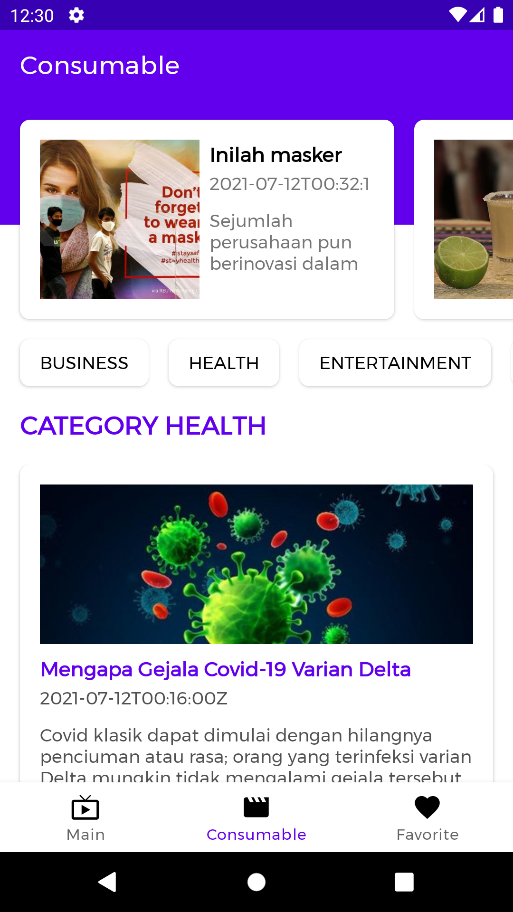
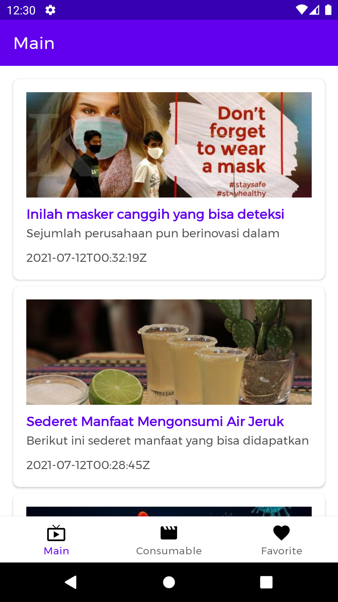
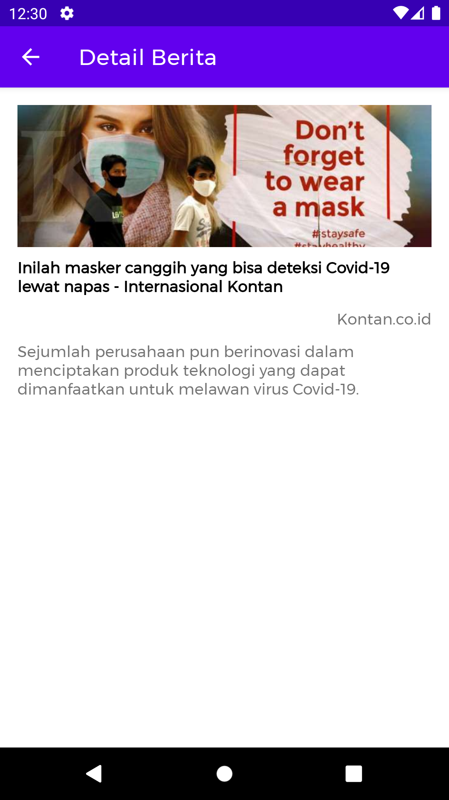

# init-android-apps

[](https://github.com/frogobox/frogo-kick-start-android/actions/workflows/android-ci.yml)

Modern, Google-standard, AI-ready Android starter template built with **Jetpack Compose Material 3**, **Clean Architecture**, **Unidirectional Data Flow (UDF)**, **Hilt**, **Room**, and **Retrofit**.

- **Architecture Deep Dive:** [ARCHITECTURE.md](ARCHITECTURE.md)
- **AI Agent Guidelines:** [AGENTS.md](AGENTS.md)
- **Privacy Policy:** [PRIVACY-POLICY.md](PRIVACY-POLICY.md)
- **License:** [LICENSE](LICENSE)

---

## Architecture Summary

The `:app` module (`io.github.amirisback.androidapp`) is organized into four clean layers aligned with Google's Official Guide to App Architecture:

- **`build-logic/convention/`** — Included Gradle composite build housing shared convention plugins (`androidapp.android.application`, `androidapp.android.application.compose`, `androidapp.android.hilt`, `androidapp.android.room`) and centralized app metadata (`ProjectSetting.kt`, `ProjectAds.kt`) backed by `gradle/libs.versions.toml`.
- **`core/`** — Shared utilities (`Resource`, JSON helpers, BuildConfig accessors), Hilt DI modules (`core/di/`), and Material 3 theme & reusable Compose components (`core/ui/`).
- **`data/`** — Retrofit API service & DTOs (`data/remote/`), Room `AppDatabase` / DAO / entities (`data/local/`), bidirectional mappers (`data/mapper/`), and `MealRepositoryImpl` (`data/repository/`).
- **`domain/`** — 100% pure Kotlin immutable domain models (`domain/model/`), repository contracts (`domain/repository/`), and use cases (`domain/usecase/`) with zero Android or network framework imports.
- **`feature/`** — Feature packages (`main`, `favorite`, `detail`, `about`) following UDF (`*UiState` + `ViewModel` + `<Feature>Route` + stateless `<Feature>Screen` with `@Preview`).

See [ARCHITECTURE.md](ARCHITECTURE.md) for the full package map, import boundary table, and step-by-step feature checklist.

---

## Tech Stack

| Category | Technology & Version |
|---|---|
| **SDK & JVM** | `minSdk 24` · `compileSdk 37` · `targetSdk 37` · JVM `17` |
| **Build & Compiler** | AGP `9.5.1` · Kotlin `2.4.21` · KSP `2.3.14` · Gradle `9.9.1` · Convention Plugins (`build-logic/convention`) |
| **UI & Design** | Jetpack Compose (BOM `2026.09.00`) · Material 3 · Edge-to-Edge |
| **Dependency Injection** | Hilt `2.60.1` |
| **Persistence** | Room `2.8.5` (with KSP schema export) |
| **Networking** | Retrofit · OkHttp · Gson · Chucker `4.4.0` |
| **Image Loading** | Coil `3.6.3` (`coil-compose`, `coil-network-okhttp`) |
| **Async & State** | Kotlin Coroutines · `Flow` · `StateFlow` (`collectAsStateWithLifecycle`) |
| **Android Utilities** | Frogo SDK `4.0.0` |
| **Testing (JVM)** | JUnit `4.13.2` · `kotlinx-coroutines-test` `1.10.2` |

---

## Getting Started (Template Customization)

1. Update application metadata (`NAME_APP`, `APP_DOMAIN`, `APP_PLAY_CONSOLE`, version code/name, database & preference names) in `build-logic/convention/src/main/kotlin/io/github/amirisback/androidapp/convention/ProjectSetting.kt`.
2. Update AdMob debug and release unit IDs in `build-logic/convention/src/main/kotlin/io/github/amirisback/androidapp/convention/ProjectAds.kt`.
3. Update `namespace` in `app/build.gradle.kts` and package directories if renaming the root package.
4. Review [ARCHITECTURE.md](ARCHITECTURE.md) and [AGENTS.md](AGENTS.md) before scaffolding new features.

---

## Build & Verification Commands

```bash
# Assemble debug APK & export Room schema via KSP
./gradlew assembleDebug

# Run JVM unit tests
./gradlew testDebugUnitTest

# Run Android Lint verification
./gradlew lintDebug
```

---

## Screenshots

| UI 1 | UI 2 | UI 3 |
|:---:|:---:|:---:|
|  |  |  |

---

## Contributors

- **Muhammad Faisal Amir** (`faisalamircs@gmail.com`)


